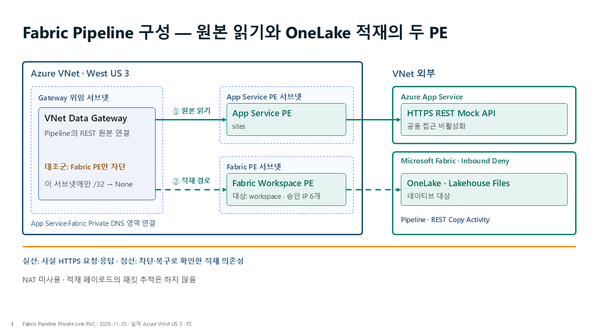
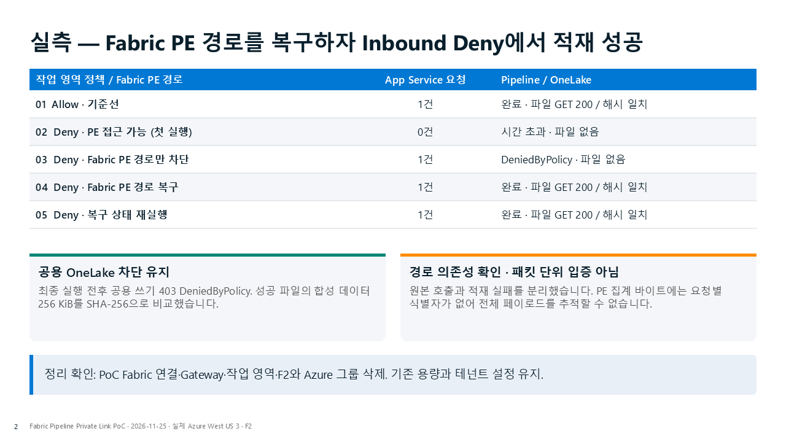
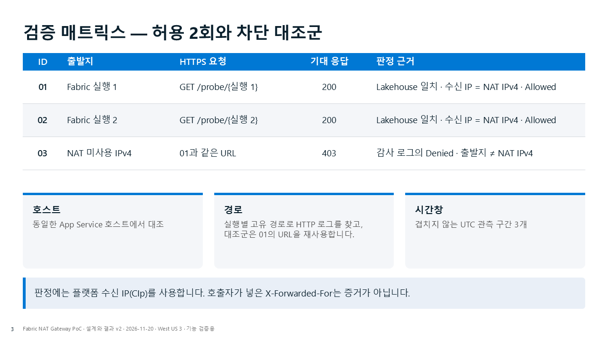
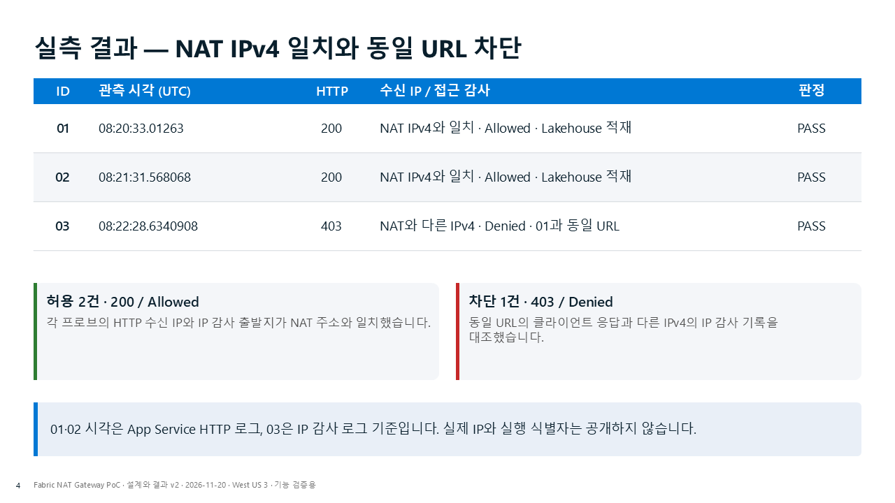
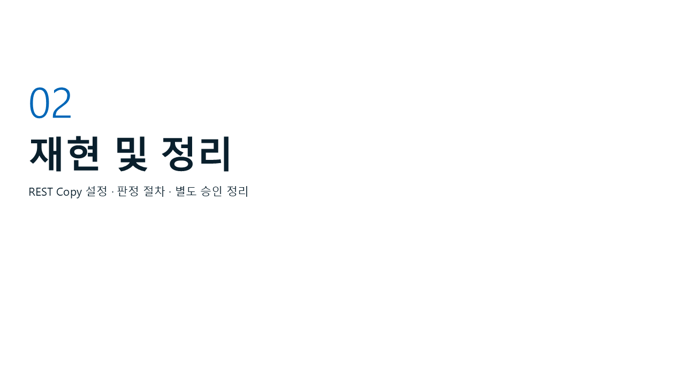
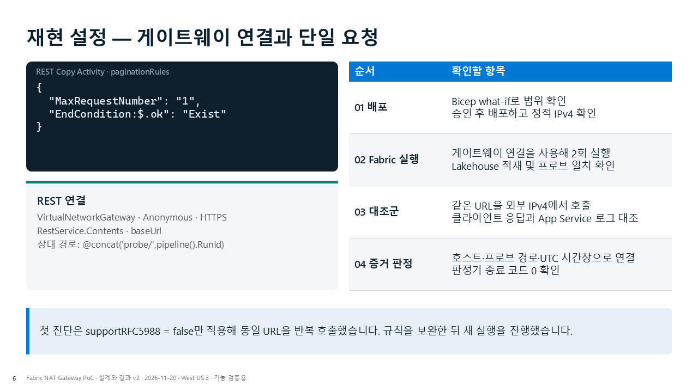

# Microsoft Fabric 네트워크 검증: NAT 송신 · Private Link 수신

이 문서는 실제 Azure West US 3에서 독립적으로 검증한 두 시나리오를 다룹니다. **NAT 고정 송신 IP**와 **Fabric Pipeline에서 사설 App Service를 읽어 `Inbound Deny` 상태의 OneLake에 적재하기**입니다.

## NAT Gateway 고정 송신 IP

Microsoft Fabric Pipeline에서 공개 HTTPS API를 호출할 때, API가 보는 출발지 IP를 Azure NAT Gateway의 정적 공인 IPv4로 고정할 수 있는지 실제 Azure에서 검증한 기록입니다. 기능 검증이며, 성능이나 고객 온프레미스 경로는 검증하지 않았습니다.

- **고정 송신 IP:** VNet Data Gateway를 사용한 Fabric REST Copy Activity 두 건이 모두 `Completed`였고, 응답이 Lakehouse에 적재됐습니다. App Service에 기록된 두 `200` 요청의 출발지 IP는 NAT IPv4와 일치했습니다.
- **`/32` 허용 목록:** NAT를 사용하지 않는 IPv4 클라이언트가 동일한 URL에서 `403`을 받았습니다. App Service IP 감사 로그에도 NAT와 다른 출발지의 `Denied`가 기록됐습니다.

**결과: 3건 PASS** (2026-11-20, West US 3). 정리 상태는 기능 판정과 별개이며 [실측 증적](evidence/README.md#정리-상태)에 마지막 확인 결과를 기록했습니다.

> **발견:** REST Copy Activity에서 `supportRFC5988 = "false"`만 지정했을 때 같은 URL을 반복 호출했습니다. `MaxRequestNumber = "1"`과 `EndCondition:$.ok = "Exist"`를 적용한 뒤, 독립적인 두 실행을 다시 검증했습니다.

## Pipeline 적재: App Service PE와 Fabric Workspace PE

**결과: 이 구성에서는 두 PE의 역할이 달랐습니다.** VNet Data Gateway는 App Service PE로 HTTPS 원본을 읽었습니다. 같은 F2 작업 영역의 네이티브 Lakehouse `Files`가 적재 대상이며, 별도 대상 Gateway 연결과 NAT Gateway는 사용하지 않았습니다.

| 작업 영역 정책 / Fabric PE 경로 | App Service 요청 | Pipeline / OneLake |
|---|---:|---|
| `Allow` 기준선 | 1 | 완료 · `GET 200`, SHA-256 일치 |
| `Deny` + PE 접근 가능, 첫 실행 | 0 | `ActionTimedOut` · 파일 `404` |
| `Deny` + Gateway 서브넷에서 Fabric PE 경로만 차단 | 1 | `DeniedByPolicy` · 파일 `404` |
| `Deny` + Fabric PE 경로 복구 (두 실행) | 각 1 | 둘 다 완료 · `GET 200`, SHA-256 일치 |

Fabric PE 경로만 차단해도 원본 호출은 성공했지만 적재가 실패했고, 경로를 복구하자 적재가 다시 성공했습니다. 최종 성공 실행 전후 공용 OneLake 쓰기는 `403 DeniedByPolicy`였습니다. 따라서 **이 구성에서 적재가 Fabric PE 접근에 의존**한다고 판단했습니다. PE의 분 단위 집계 바이트로는 전체 적재 페이로드의 통과를 패킷 단위로 입증할 수 없습니다.

**정리:** 2026-11-25 재조회에서 Pipeline PoC의 Fabric 연결·게이트웨이·작업 영역·임시 F2와 Azure 그룹의 부재를 확인했습니다. 기존 Fabric 용량과 테넌트 설정은 유지했습니다.

[편집 가능한 PowerPoint](deck/fabric-pipeline-private-v1.pptx) · [YAML 원본](deck/fabric-pipeline-private-v1.yaml) · [발표 노트](deck/fabric-pipeline-private-v1.script.md) · [Pipeline 재현 절차](docs/runbook-pipeline-private.md) · [비식별 실측 증적](evidence/fabric-pipeline-private.json)

### Pipeline 구성도

### Pipeline 실측과 판정

## 저장소 구성

| 경로 | 내용 |
|---|---|
| [`deck/`](deck/) | **NAT 송신 및 Private Link 수신 검증 장표** PPTX, YAML 원본, 한국어 발표 노트, 슬라이드별 PNG |
| [NAT](docs/runbook.md) · [Pipeline 사설 적재](docs/runbook-pipeline-private.md) | 시나리오별 검증 구성, 판정 기준 및 정리 |
| [실측 증적](evidence/README.md) | 실측 결과와 정리 상태. 원본 로그와 실제 IP·식별자는 제외 |
| [설계](docs/superpowers/specs/2026-11-20-fabric-vnet-gateway-nat-poc-design.md) · [구현 계획](docs/superpowers/plans/2026-11-20-fabric-vnet-gateway-nat-poc.md) | 검증 범위, 접근 정책과 단계별 판정 기준 |
| [NAT 인프라](infra/main.bicep) · [Pipeline 인프라](infra/pipeline-private-poc/) | 시나리오별 전용 Azure 리소스를 배포하는 Bicep |
| [`mock-api/`](mock-api/) | NAT용 합성 JSON과 [Pipeline용 256 KiB 합성 데이터](mock-api/pipeline/server.mjs)를 반환하는 Node.js Mock API 및 HTTP 테스트 |
| [`scripts/`](scripts/) · [`tests/`](tests/) | 실측 증거 판정기, 인프라 구조 및 판정 회귀 테스트 |

## 장표

수신 장표는 위의 [Pipeline 사설 적재 2장](#pipeline-구성도)에서 볼 수 있습니다.

[편집 가능한 PowerPoint v2](deck/fabric-nat-design-v2.pptx) · [YAML 원본](deck/fabric-nat-design-v2.yaml) · [발표 노트](deck/fabric-nat-design-v2.script.md) · [전체 미리보기](deck/fabric-nat-design-v2_render/contact_sheet.png)

아래에서 NAT 송신 검증 v2 장표 7장을 순서대로 볼 수 있습니다. 이미지를 클릭하면 원본 크기로 열립니다.

### 1. 검증 샘플 구성

NAT Gateway는 VNet의 위임 서브넷에 연결하는 별도 관리형 리소스입니다. 그림에서는 VNet 경계 안, 위임 서브넷 경계 밖에 배치하고 연결 설정을 주황 점선으로 표시했습니다. 공개 HTTPS Mock API는 VNet 밖에 있습니다.

### 01 네트워크 검증

#### 2. 네트워크 검증 섹션

#### 3. 검증 매트릭스

#### 4. 실측 결과

### 02 재현 및 정리

#### 5. 재현 및 정리 섹션

#### 6. Fabric 재현 설정

#### 7. 검증 범위와 리소스 정리 상태

## 재현 순서

아래는 NAT 송신 검증 순서입니다. 수신 시나리오는 [Pipeline 사설 적재](docs/runbook-pipeline-private.md)를 참고하세요.

1. [로컬 검증](docs/runbook.md#로컬-검증): Azure 리소스를 만들지 않고 Bicep, Mock API, 증거 판정기를 확인합니다.
2. [Azure 미리보기와 배포](docs/runbook.md#azure-미리보기와-배포): PoC 전용 그룹으로 범위를 제한하고 승인 후 배포합니다.
3. [Fabric 호출과 로그 대조](docs/runbook.md#fabric-호출과-로그-대조): 허용 요청 두 건과 동일 URL의 차단 대조군 한 건을 확인합니다.
4. [정리](docs/runbook.md#정리): 별도 승인 후 PoC 리소스만 삭제하고 Azure와 Fabric에서 삭제 여부를 확인합니다.
