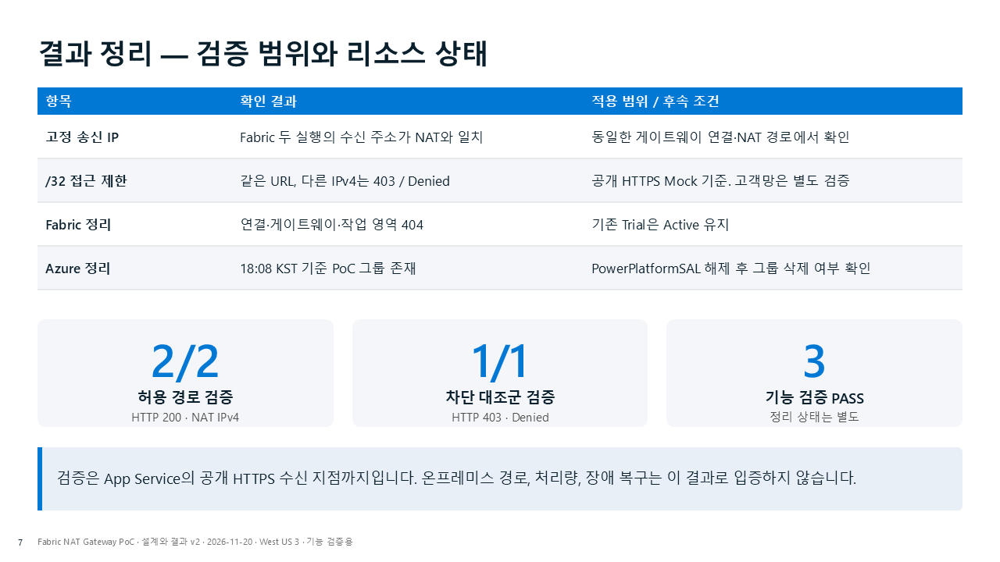

# Microsoft Fabric 네트워크 검증: NAT 송신 · Private Link 수신

두 시나리오를 실제 Azure West US 3에서 독립적으로 검증했습니다. NAT 테스트는 **Fabric에서 외부 API로 나가는 송신**을, Private Link 테스트는 **VNet에서 Fabric OneLake로 들어가는 수신**을 확인합니다.

## NAT Gateway 고정 송신 IP

Microsoft Fabric Pipeline에서 공개 HTTPS API를 호출할 때, API가 보는 출발지 IP를 Azure NAT Gateway의 정적 공인 IPv4로 고정할 수 있는지 실제 Azure에서 검증한 기록입니다. 기능 검증이며, 성능이나 고객 온프레미스 경로는 검증하지 않았습니다.

- **고정 송신 IP:** VNet Data Gateway를 사용한 Fabric REST Copy Activity 두 건이 모두 `Completed`였고, 응답이 Lakehouse에 적재됐습니다. App Service에 기록된 두 `200` 요청의 출발지 IP는 NAT IPv4와 일치했습니다.
- **`/32` 허용 목록:** NAT를 사용하지 않는 IPv4 클라이언트가 동일한 URL에서 `403`을 받았습니다. App Service IP 감사 로그에도 NAT와 다른 출발지의 `Denied`가 기록됐습니다.

**결과: 3건 PASS** (2026-11-20, West US 3). 정리 상태는 기능 판정과 별개이며 [실측 증적](evidence/README.md#정리-상태)에 마지막 확인 결과를 기록했습니다.

> **발견:** REST Copy Activity에서 `supportRFC5988 = "false"`만 지정했을 때 같은 URL을 반복 호출했습니다. `MaxRequestNumber = "1"`과 `EndCondition:$.ok = "Exist"`를 적용한 뒤, 독립적인 두 실행을 다시 검증했습니다.

## Inbound Deny와 OneLake Private Endpoint

**결과: PASS** (2026-11-25, West US 3). 임시 F2에 연결한 전용 작업 영역에만 `Inbound Deny`를 적용했습니다. 같은 계정으로 동일한 Lakehouse의 `Files`에 OneLake Blob API를 호출했습니다. Fabric Pipeline, VNet Data Gateway, NAT Gateway는 이 수신 시험에 사용하지 않았습니다.

| 검증 경로 | `Deny` 적용 전 | `Deny` 적용 후 |
|---|---|---|
| VNet 외부 → 공용 OneLake | 쓰기 `201` | 쓰기 `403 DeniedByPolicy` |
| VNet 내부 → 작업 영역 Private Endpoint → OneLake | 쓰기 `201` | 쓰기 `201`, 재읽기 `200`, 원본 SHA-256 일치 |

사설 요청의 DNS 응답과 실제 HTTPS 연결 IP가 모두 승인된 Private Endpoint NIC의 IP와 일치했습니다. PoC 작업 영역, 임시 F2, Azure 리소스 그룹은 삭제 후 재조회로 확인했습니다. 기존 Trial과 테넌트 설정은 변경하지 않았습니다.

[Private Link 재현 절차](docs/runbook-inbound-private.md) · [비식별 실측 증적](evidence/fabric-inbound-private.json)

## 저장소 구성

| 경로 | 내용 |
|---|---|
| [`deck/`](deck/) | **NAT 송신 검증 장표** PPTX, YAML 원본, 한국어 발표 노트, 슬라이드별 PNG |
| [NAT 실행 안내](docs/runbook.md) · [Private Link 실행 안내](docs/runbook-inbound-private.md) | 검증 구성, 판정 기준 및 정리 |
| [실측 증적](evidence/README.md) | 두 시나리오의 실측 결과와 정리 상태. 원본 로그와 실제 IP·식별자는 제외 |
| [설계](docs/superpowers/specs/2026-11-20-fabric-vnet-gateway-nat-poc-design.md) · [구현 계획](docs/superpowers/plans/2026-11-20-fabric-vnet-gateway-nat-poc.md) | 검증 범위, 접근 정책과 단계별 판정 기준 |
| [NAT 인프라](infra/main.bicep) · [Private Link 인프라](infra/inbound-poc/) | 시나리오별 전용 Azure 리소스를 배포하는 Bicep |
| [`mock-api/`](mock-api/) | 합성 JSON만 반환하는 Node.js Mock API와 HTTP 테스트 |
| [`scripts/`](scripts/) · [`tests/`](tests/) | 실측 증거 판정기, 인프라 구조 및 판정 회귀 테스트 |

## 장표

[편집 가능한 PowerPoint v2](deck/fabric-nat-design-v2.pptx) · [YAML 원본](deck/fabric-nat-design-v2.yaml) · [발표 노트](deck/fabric-nat-design-v2.script.md) · [전체 미리보기](deck/fabric-nat-design-v2_render/contact_sheet.png)

아래에서 NAT 송신 검증 v2 장표 7장을 순서대로 볼 수 있습니다. 이미지를 클릭하면 원본 크기로 열립니다.

### 1. 검증 샘플 구성

NAT Gateway는 VNet의 위임 서브넷에 연결하는 별도 관리형 리소스입니다. 그림에서는 VNet 경계 안, 위임 서브넷 경계 밖에 배치하고 연결 설정을 주황 점선으로 표시했습니다. 공개 HTTPS Mock API는 VNet 밖에 있습니다.

### 01 네트워크 검증

#### 2. 네트워크 검증 섹션

#### 3. 검증 매트릭스

#### 4. 실측 결과

### 02 재현 및 정리

#### 5. 재현 및 정리 섹션

#### 6. Fabric 재현 설정

#### 7. 검증 범위와 리소스 정리 상태

## 재현 순서

아래는 NAT 송신 검증 순서입니다. 별도 수신 시나리오는 [Private Link 재현 절차](docs/runbook-inbound-private.md)를 참고하세요.

1. [로컬 검증](docs/runbook.md#로컬-검증): Azure 리소스를 만들지 않고 Bicep, Mock API, 증거 판정기를 확인합니다.
2. [Azure 미리보기와 배포](docs/runbook.md#azure-미리보기와-배포): PoC 전용 그룹으로 범위를 제한하고 승인 후 배포합니다.
3. [Fabric 호출과 로그 대조](docs/runbook.md#fabric-호출과-로그-대조): 허용 요청 두 건과 동일 URL의 차단 대조군 한 건을 확인합니다.
4. [정리](docs/runbook.md#정리): 별도 승인 후 PoC 리소스만 삭제하고 Azure와 Fabric에서 삭제 여부를 확인합니다.
