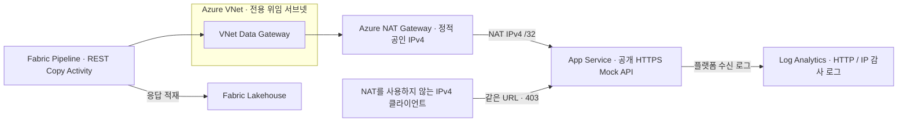

# Fabric VNet Data Gateway · NAT Gateway 고정 송신 IP 검증

Microsoft Fabric Pipeline에서 공개 HTTPS API를 호출할 때, API가 보는 출발지 IP를 Azure NAT Gateway의 정적 공인 IPv4로 고정할 수 있는지 실제 Azure에서 검증한 기록입니다. 기능 검증이며, 성능이나 고객 온프레미스 경로는 검증하지 않았습니다.

- **고정 송신 IP:** VNet Data Gateway를 사용한 Fabric REST Copy Activity 두 건이 모두 `Completed`였고, 응답이 Lakehouse에 적재됐습니다. App Service에 기록된 두 `200` 요청의 출발지 IP는 NAT IPv4와 일치했습니다.
- **`/32` 허용 목록:** NAT를 사용하지 않는 IPv4 클라이언트가 동일한 URL에서 `403`을 받았습니다. App Service IP 감사 로그에도 NAT와 다른 출발지의 `Denied`가 기록됐습니다.

**결과: 3건 PASS** (2026-11-20, West US 3). 정리 상태는 기능 판정과 별개이며 [실측 증적](evidence/README.md#정리-상태)에 마지막 확인 결과를 기록했습니다.

> **발견:** REST Copy Activity에서 `supportRFC5988 = "false"`만 지정했을 때 같은 URL을 반복 호출했습니다. `MaxRequestNumber = "1"`과 `EndCondition:$.ok = "Exist"`를 적용한 뒤, 독립적인 두 실행을 다시 검증했습니다.

## 저장소 구성

| 경로 | 내용 |
|---|---|
| [실행 안내](docs/runbook.md) | 로컬 검증, Azure 미리보기·배포, Fabric 구성, 로그 대조와 정리 |
| [실측 증적](evidence/README.md) | 실제 실행 3건의 결과와 마지막 정리 확인. 원본 로그와 실제 IP·식별자는 제외 |
| [설계](docs/superpowers/specs/2026-11-20-fabric-vnet-gateway-nat-poc-design.md) · [구현 계획](docs/superpowers/plans/2026-11-20-fabric-vnet-gateway-nat-poc.md) | 검증 범위, 접근 정책과 단계별 판정 기준 |
| [`infra/`](infra/) | NAT와 위임 서브넷, App Service 접근 제한, Log Analytics를 배포하는 Bicep |
| [`mock-api/`](mock-api/) | 합성 JSON만 반환하는 Node.js Mock API와 HTTP 테스트 |
| [`scripts/`](scripts/) · [`tests/`](tests/) | 실측 증거 판정기, 인프라 구조 및 판정 회귀 테스트 |

## 검증 구성

App Service는 NAT IPv4 `/32`만 허용합니다. 수신 IP는 Mock 응답이나 `X-Forwarded-For`가 아니라 App Service 플랫폼 로그의 `CIp`로 판정했습니다.

## 재현 순서

1. [로컬 검증](docs/runbook.md#로컬-검증): Azure 리소스를 만들지 않고 Bicep, Mock API, 증거 판정기를 확인합니다.
2. [Azure 미리보기와 배포](docs/runbook.md#azure-미리보기와-배포): PoC 전용 그룹으로 범위를 제한하고 승인 후 배포합니다.
3. [Fabric 호출과 로그 대조](docs/runbook.md#fabric-호출과-로그-대조): 허용 요청 두 건과 동일 URL의 차단 대조군 한 건을 확인합니다.
4. [정리](docs/runbook.md#정리): 별도 승인 후 PoC 리소스만 삭제하고 Azure와 Fabric에서 삭제 여부를 확인합니다.
